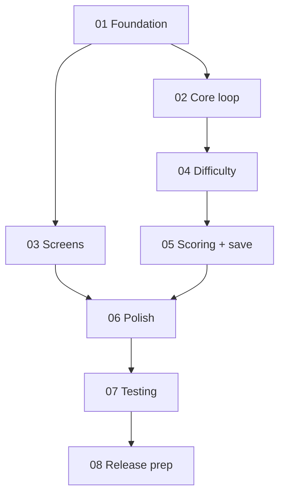

# Keeper of the Cove — Implementation Plan

Simple, honest scope for a small offline game. Always the simplest method that works. Each phase is built by its own sub-agent reading only its phase file plus `GDD.md`, `DESIGN_LANGUAGE.md`, and `COMPLIANCE.md`.

## Phases

| # | Phase | Summary | Depends on |
|---|-------|---------|-----------|
| 01 | Theme & app foundation | Palette/type constants, MaterialApp, named routes, screen stubs | none |
| 02 | Core mechanic & loop | `CoveGame`: lighthouse, drag beam, vessel, charting, harbor, rocks | 01 |
| 03 | Screens & navigation | Splash, menu, pause, win/lose, log, how-to-play, privacy + flow | 01 |
| 04 | Levels, progression & difficulty | `night_config.dart` table + scaling spawner | 02 |
| 05 | Scoring & win/lose + persistence | `game_state.dart`: embers, quota, dawn timer, score, best stats | 04 |
| 06 | Art, sound & theme polish | Apply palette/motion/fog/glow + ambient audio | 03, 05 |
| 07 | Testing & bug fixing | `flutter analyze`, widget tests, responsiveness, offline check | 06 |
| 08 | Final build & release prep | Icon, metadata, version, release config notes | 07 |

## Dependency graph

## Build waves (for game-build sub-agents)
- **Wave 1:** Phase 01 (everything depends on it).
- **Wave 2:** Phase 02 + Phase 03 in parallel (different file trees: `lib/game/` vs `lib/screens/`).
- **Wave 3:** Phase 04.
- **Wave 4:** Phase 05.
- **Wave 5:** Phase 06.
- **Wave 6:** Phase 07.
- **Wave 7:** Phase 08.

Most logic lives in the shared game files, so true parallelism is limited to Wave 2; later phases run one sub-agent each (fresh context, no overload) and stay sequential for correctness.

## Status
| Phase | Status | Notes |
|-------|--------|-------|
| 01 | done | Theme (cove_theme.dart), KeeperApp shell + named routes, 8 screen stubs. flutter analyze clean. |
| 02 | done | CoveGame (FlameGame + DragCallbacks, no-arg ctor); components: lighthouse, beam (point-in-cone), vessel (chartProgress→harbor/lost), harbor, rocks. Hooks: onVesselSaved/onVesselLost. flutter analyze clean. |
| 03 | done | 8 screens + Keeper's Rest overlay + shared widgets in lib/screens/. Splash→menu→{night,log,duty,promise}; night pause→{relight,menu,duty}; dawn/dark→night. Static placeholders; CoveGame embedded per contract. |
| 04 | done | night_config.dart (NightConfig + configForNight, GDD §6 table, clamps past night 7). CoveGame takes optional NightConfig (defaults night 1, CoveGame() still compiles); drives maxVesselsAtOnce + spawn cadence, vesselSpeed, beamReach (size.y*reach), Rocks teeth. flutter analyze clean. |
| 05 | done | game_state.dart: GameState (ChangeNotifier, shared instance) — embers(3)/soulsHome/quota/score/streak+multiplier/dawn timer/night + run totals. CoveGame hooks wired; win(quota)→/dawn, lose(0 embers or dawn deadline)→/dark; pause freezes game+timer via Ticker. Live HUD on night screen. Best run saved via shared_preferences (cove_best_souls_home, cove_best_nights_survived, cove_best_longest_streak); BestStats.load() for logbook. flutter analyze clean. |
| 06 | done | Sea/Fog components + vessel rocking + beam glow (all canvas-drawn); pause dialog fades in, 3-2-1 relight count-in. flame_audio: ambient sea loop (bgm, pause/resume/stop) + soul-home chime, guarded; PLACEHOLDER assets at assets/audio/{ambient_sea_loop,soul_home_chime}.ogg (see README). Logbook wired to BestStats.load(). flutter analyze clean. |
| 07 | done | flutter analyze clean; flutter test green (26 tests): configForNight scaling, game_state scoring/embers/win-lose, splash→menu boot + menu→night navigation, responsiveness at 360×640 & 430×930 with ≥48dp targets. Fixed Log + Dawn overflow (now scroll). Offline verified: no networking in lib/, no extra Android permissions. |
| 08 | done | App label "Keeper of the Cove"; applicationId com.coastlight.keeper_of_the_cove. version 1.0.0+1; description = one-line pitch. Icon: amber-beam-on-indigo source at assets/icon/app_icon.png, generated via flutter_launcher_icons (dev_dependency + config) → legacy mipmaps + adaptive icon. Release config sound (no debug-only flags); signing/proguard Play Core -dontwarn/GitHub Actions handed to game-ci. flutter analyze clean. |
